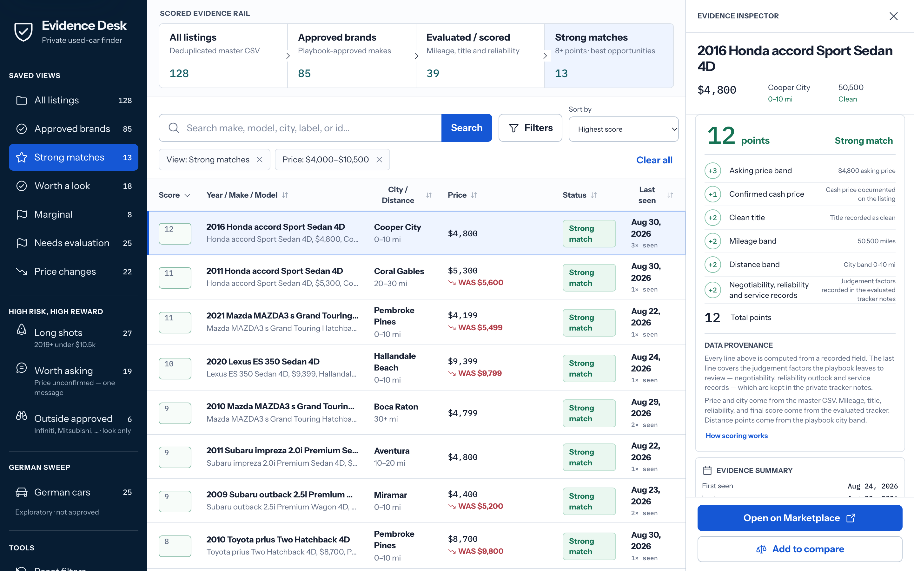

# car-scraper

[](https://github.com/yaminsadik/car-scraper/actions/workflows/test.yml)

A human-in-the-loop pipeline for finding a used car on Facebook Marketplace. You
scroll a search in your own Chrome; a small Node.js tool reads the loaded cards
over the Chrome DevTools Protocol; an AI assistant triages and scores them against
a written playbook; a deal tracker follows each seller conversation from VIN request
to appointment; and a React dashboard explains every score.



<sub>Evidence Desk on the bundled demo dataset. Every listing, ID and price shown is synthetic.</sub>

I built this for my own search in South Florida and used it end to end: about
11,700 Marketplace cards captured, 1,700+ triaged against the playbook, and 77 seller
conversations tracked, ending in a purchase.

## The problem

Marketplace is where the cheapest private-party cars are, and it resists every
shortcut. Testing showed two things that shaped the whole design:

- **Most vehicle filters are cosmetic.** Facebook's Make and Body style filters
  populate the sidebar and change nothing about the results, so brand and body
  type have to be read off the card title.
- **Automated scrolling never triggers the feed loader.** A scripted scroll stops at
  Facebook's 24-card page size. The same slice scrolled by hand returned 264
  listings.

So the work is split: a person scrolls, a tool reads, an agent applies the rules,
and every irreversible step (messaging a seller, driving to see a car, paying) stays
with the person.

## Engineering highlights

- **Read-only browser integration over raw CDP.** `tools/marketplace-cdp` attaches to
  the user's signed-in Chrome with a single runtime dependency (`ws`). It never
  scrolls, clicks or types. It pins the exact tab it opened and refuses to guess when
  several search tabs could match.
- **One source of truth for the rules.** Every criterion lives in
  [`used_car_buying_playbook.md`](used_car_buying_playbook.md). The tools read it at
  run time rather than hardcoding a copy. The deal tracker parses the pre-visit
  requirements table, and the dashboard parses brands, distance bands and scoring
  tables. If the requirements table stops parsing, the deal tracker throws instead
  of falling back to a stale copy.
- **A three-tier data model.** Raw captures hold every card and are written only by
  tools. The curated tracker records why each triaged car was kept or dropped. Deal
  files hold one page of markdown per seller conversation. Each tier has its own write
  pattern, which avoids rewriting a 1 MB table to record one sentence a seller said.
- **Claims are not verification.** A VIN is validated by check digit and model-year
  decode before it is stored. A seller writing "no warning lights" is recorded as a
  claim. A photo nobody has reviewed is a computed blocker until a person describes
  what it showed.
- **Explainable scoring.** Evidence Desk rebuilds each score as a ledger of factors
  from structured tracker columns, and flags tracker scores that can't be reconciled
  with the playbook.
- **Privacy enforced by the build.** The snapshot builder strips phone numbers,
  emails, VINs and quoted seller text from listing data. A scan then fails the
  production build if any of them remain. Real captures are gitignored, and test
  fixtures use synthetic IDs, names and VINs.
- **Rules corrected by measurement.** A card-level "down payment" screen turned out
  to be 75% false positives on 2019–2020 cars once those listings were opened. It
  became a triage hint instead of a rejection. The playbook and
  [`DEV-JOURNAL.md`](DEV-JOURNAL.md) record changes like this with the evidence
  behind them.

## Architecture

```text
               used_car_buying_playbook.md — filters, scoring, visit gates
                 │ followed by the agent        │ parsed at run time by the tools
                 ▼                              ▼
 Chrome, scrolled by hand
   │  DevTools Protocol
   ▼
 mp.js read ──► captures/feeds/*.json ──► merge.js ──► captures/master.csv     Tier 1 · every card
                                                          │ agent triage + scoring
                                                          ▼
                                                    seen_listings.md           Tier 2 · every car triaged
                                                          │ seller replies (sent by hand)
                                                          ▼
                           mp.js inbox / thread / deal ──► deals/<id>.md        Tier 3 · conversations
                                                          │
                     web/scripts/build-data.mjs ──► scan-snapshot.mjs ──► Evidence Desk
```

[`WORKFLOW.md`](WORKFLOW.md) walks through the pipeline in prose, and
[`workflow.html`](workflow.html) shows it as a diagram.
[`PROCESS_DESIGN.md`](PROCESS_DESIGN.md) is the method I took from building it: how
to design a pipeline end to end before writing the first tool.

## Try it without a Facebook account

Requires Node.js 20.19 or newer.

```bash
git clone https://github.com/yaminsadik/car-scraper.git
cd car-scraper

# Capture tool and deal tracker: unit tests on synthetic fixtures
cd tools/marketplace-cdp && npm ci && npm test

# Evidence Desk on the bundled demo dataset
cd ../../web && npm ci && npm run dev
```

The demo snapshot in `web/public/data/` is built from the synthetic inputs in
`web/demo/` by the same builder and scan a real search uses. Regenerate it with
`npm run data:demo`.

## Running a real search

You need macOS, Google Chrome, and a Facebook account signed in to Marketplace. In
Chrome, open `chrome://inspect/#remote-debugging` and enable remote debugging for the
browser instance. The tool connects only to the local DevTools endpoint that Chrome
records.

```bash
cd tools/marketplace-cdp && npm ci && cd ../..
cp templates/search_checkpoint.md search_checkpoint.md
cp templates/seen_listings.md seen_listings.md
mkdir -p captures/feeds captures/items
```

Then, for each search slice, from `tools/marketplace-cdp`:

```bash
node mp.js open "<Marketplace search URL>"   # opens, focuses and pins the tab
# scroll the pinned tab to the bottom by hand
node mp.js read --out ../../captures/feeds/2026-08-21_4000-10500.json
node merge.js                                # rebuild captures/master.csv
node validate.js                             # read-only consistency checks
```

If `read` reports 24 cards or fewer, the tab wasn't scrolled. Go back and scroll
before using the output. The playbook covers the rest: URL construction, triage,
scoring, reliability research, and when to checkpoint. It is written for an AI
assistant with browser access and is kept copy-pasteable into Claude, ChatGPT or
similar tools.

| Command | Purpose |
|---|---|
| `node mp.js tabs` | List Chrome tabs and show which one is pinned |
| `node mp.js open <url>` | Open, focus and pin a Marketplace search tab |
| `node mp.js read [--out file]` | Read the loaded cards from the pinned tab |
| `node mp.js item <ids...> --out file` | Capture listing-page text for review |
| `node mp.js msg [ids...] --next` | Stage the next seller question for you to send by hand |
| `node mp.js inbox` | Find conversations that moved since the last sweep |
| `node mp.js thread <id>` | Read one seller conversation and save its photos |
| `node mp.js deal [due \| open \| vin \| appt \| close ...]` | Per-conversation deal tracker |
| `node merge.js` | Merge feed captures into `captures/master.csv` |
| `node validate.js` | Check captures, tracker uniqueness and checkpoint counts |

[`tools/marketplace-cdp/README.md`](tools/marketplace-cdp/README.md) documents each
command, and [`web/README.md`](web/README.md) covers the dashboard.

## What it will not do

- **Contact sellers.** Message templates are copied to the clipboard for you to send.
  The tracker records what was sent and what came back.
- **Drive the browser.** It reads the tab you scrolled. It never scrolls, clicks or
  types.
- **Decide for you.** Scores rank listings. A person chooses which ones become deals.

## Repository map

| Path | Contents |
|---|---|
| [`used_car_buying_playbook.md`](used_car_buying_playbook.md) | Every search rule: filters, scoring, red flags, visit gates, output format |
| [`tools/marketplace-cdp/`](tools/marketplace-cdp/) | CDP capture, merge and validation, deal tracker, inbox and thread readers, message queue |
| [`web/`](web/) | Evidence Desk: React 19 and Vite, snapshot builder, privacy scan, demo fixtures |
| [`DEV-JOURNAL.md`](DEV-JOURNAL.md) | Dated engineering notes on what went wrong and what changed |
| [`BRAND_SWEEPS_PLAN.md`](BRAND_SWEEPS_PLAN.md) | Runbook for per-brand keyword sweeps |
| [`CLAUDE.md`](CLAUDE.md) | Operating instructions for AI agents working in this repo |
| [`templates/`](templates/) | Clean starter state for a new search |
| `captures/`, `archive/` | Private working data; gitignored apart from their READMEs |

## Development

```bash
npm --prefix tools/marketplace-cdp test   # 73 tests, node:test, no browser needed
npm --prefix web run build                # data build, privacy scan, Vite build
npm --prefix web run test:sites           # static-host routing tests
```

CI runs all three on every push. Tooling stays mechanical: buying rules belong in the
playbook, never in `tools/`. If a bug needs a fixture, write a small synthetic record
under `test/` rather than copying a real listing.

This repository is a curated public export of a private working repo. Real captures,
trackers, seller conversations and deal files are not included.
