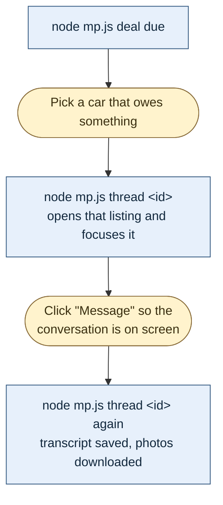
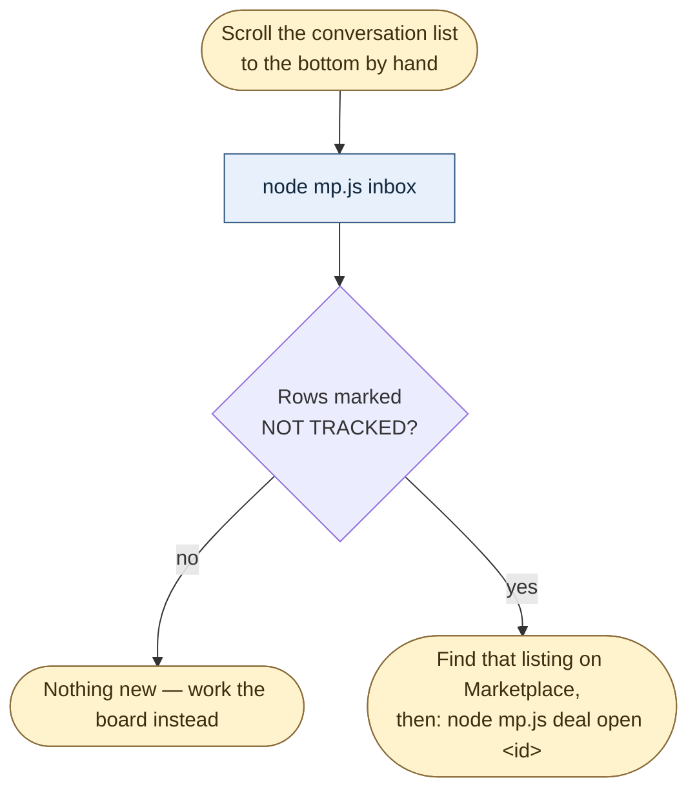
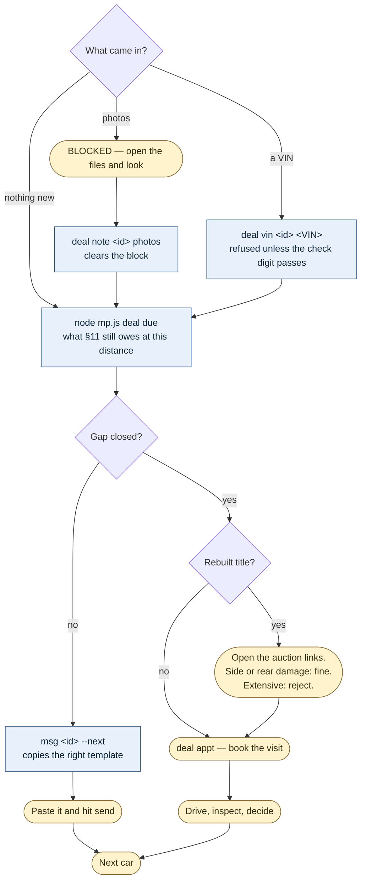

# Search Workflow

A plain-language walkthrough of how a run works, and why each stage exists.
The visual version is `workflow.html` — open it in a browser.

Reference: `used_car_buying_playbook.md`. Section numbers below point there.

---

## The one idea behind the whole design

**Rejection should be free.**

Opening a Facebook listing is the expensive step — it costs a page load, a
description expansion, and a chunk of the assistant's limited context. Every
rejection that happens *before* that step is essentially free.

So the workflow is arranged as a funnel: cheap, broad checks first, expensive
checks last. Of the first 106 listings ever processed, **67 could have been
rejected from the search card alone** — brand, body type and price are all
printed right there. Reliability research, the most expensive step of all,
runs on survivors only.

This matters more than it sounds, because Facebook does not help. Most of its
vehicle filters are cosmetic (§8): the Make filter, the Body style filter and
the Cars & Trucks filter all populate the sidebar and change nothing about the
results. Filtering that Facebook appears to offer has to be done by hand,
from the card.

---

## Stage 0 — Load state

Read three files before touching a browser:

| File | Answers |
|---|---|
| `used_car_buying_playbook.md` | What are the rules? |
| `search_checkpoint.md` | Where did the last run stop? |
| `seen_listings.md` | Which listings have already been judged? |
| `deals/INDEX.md` | Which sellers am I mid-conversation with, and what does each one still owe? |

Skipping this is how a run ends up re-opening fifty listings it already
rejected last week.

---

## Stage 1 — Choose a sweep and build the URL

Two sweeps, because they fail in different ways and cover for each other.

**Sweep A — mileage-ordered, all brands.** The primary baseline.

Mileage is the one hard filter that *cannot* be read from a card — it always
costs a listing open, and it was the second-largest rejection reason. But
mileage **sorting** works even though mileage *filtering* leaks. So instead of
opening listings and discovering they have 190,000 miles, walk each price
slice from the lowest mileage upward and stop when listings cross 110,000.
Mileage stops being a per-listing rejection and becomes a stopping condition.
Everything below the line is pre-qualified.

**Sweep B — brand keyword search.** The per-brand top-up.

This replaces the native Make filter, which does not work. A keyword search
for `toyota` returned 12 Toyotas in the first 24 results; the "native" Make
filter returned 4. Still fuzzy — other brands leak through — but far better,
and the leakage is free to reject from the card.

**Always build the URL directly. Never click the filter panel.** Coordinate
clicks on the price and mileage fields are fragile; one prior run corrupted a
price into $40,004,000 from stray clicks landing on the wrong field.

---

## Stage 2 — Read cards in batches

Capture Listing IDs first, before evaluating anything. IDs are the dedupe key
and the cheapest thing on the page.

---

## Stage 3 — Card-level triage (the important one)

Everything in this stage is free. Nothing is opened.

| What you check | Where it is on the card | Outcome |
|---|---|---|
| **Brand** | First words of the title | Not on the approved list → `Rejected: brand` |
| **Body type** | Title suffix — `Sedan 4D`, `Minivan 4D`, `Pickup 4D`, `Van 4D`, `Wagon 4D` | Minivan / pickup / van / convertible → `Rejected: body type` |
| **Asking price** | Card | Above $10,500 → `Rejected: price` |
| **Year vs. price** | Title year + price | 2019 or newer at ≤$10,500 → flag `Suspected down payment` |
| **City** | Under the price | **Not a rejection.** Record the distance band for scoring. |
| **Struck-through price** | Card | Record — the seller has already come down once |

Two of these deserve explanation.

**Why body type is readable from a card.** Facebook appends its own body-style
string to most vehicle titles — "2014 Nissan Sentra SV **Sedan 4D**". That
string is Facebook's own classification, not the seller's wording, so it is
reliable when present. When it is absent, the listing has to be opened.

**Why the year-vs-price screen exists.** Roughly a quarter of listings in this
market are disguised down-payment ads: the headline number is a financing
down payment, not the price of the car. They give themselves away because they
advertise late-model cars at economy-car prices. A 2025 RAV4 at $4,000 and a
2026 4Runner at $5,000 are not bargains — they are financing ads. Screening
year against price catches them from the card, before anyone reads a
description.

---

## Stage 4 — Dedupe

Check surviving IDs against the tracker.

Permanent rejections — brand, body type, mileage, title — are never re-opened,
because those facts cannot change. `Rejected: price` **is** re-checked, because
sellers cut prices and an over-budget car can come back into range.

Known permanent rejections do not need to be opened again.

---

## Stage 5 — Open the listing

There is no artificial per-chat open limit. Checkpoint every 5 listing opens;
continue until the cell is complete, the user stops, or a real constraint
requires a clean handoff. Card triage remains unlimited. When the constraint
is the assistant’s context window, freeze the remaining ID queue in the
current chat and hand packed worker prompts to new Agent chats rather than
compacting or asking the next chat to rediscover the queue — `DEV-JOURNAL.md`.

Use one reusable scratch tab. Expand the description once and collect every
field in a single pass. Never reopen a listing to fetch one more field.

Mileage and title status live only here, never on the grid. So does the full
description, which is where financing language, disclosed defects and
curbstoning tells are found.

---

## Stage 6 — Hard filters

| Check | Reject if |
|---|---|
| Mileage | Over 110,000 |
| Title | Salvage, flood, junk, "no title", "bill of sale only" |
| Body type | Anything excluded that the card didn't reveal |
| Price | Asking above $10,500 |

Log every listing opened — passes *and* rejections — with a one-line reason.
The rejections are what stop the next run from repeating the work.

---

## Stage 7 — Reliability research (survivors only)

Research the exact model year and powertrain — not the brand. A 2010 Corolla
and a 2010 Camry Hybrid have very different ownership costs, and "Toyota is
reliable" tells you nothing useful about either.

This is the single most expensive step in the workflow, which is why it runs
last and only on listings that already passed everything cheap. Reuse a prior
assessment for the same year/model/powertrain when one exists in the tracker.

---

## Stage 8 — Red flags and scoring

Run the §6 checklist, then score per §5.

Score comes from six factors: price band, price type, negotiability, title,
mileage, distance, and reliability. Two rules are worth knowing:

- **A listing whose price is unknown cannot be a Strong match.** If financing
  language is present, the price band awards zero points, a −1 penalty
  applies, and the tier is capped at "Worth a look" until the seller confirms
  a real cash price. Scoring an unverified $9,500 down payment as if it were a
  $9,500 car is exactly how three financing ads previously reached the
  shortlist.
- **Distance is graded, not fatal.** +2 within 10 miles down to −1 beyond 30.
  A far car is one that has to be worth the drive.

Tiers: **8+ Strong match** · **4–7 Worth a look** · **below 4 Marginal**.

---

## Stage 9 — Persist

Update `seen_listings.md` with a complete row per listing, and
`search_checkpoint.md` at least every 5 listings. Save continuously, not at
the end — a run that dies mid-way should lose nothing.

Run `node tools/marketplace-cdp/validate.js` before handoff. Validation is
read-only; it catches duplicate tracker IDs, malformed captures, stale
checkpoint counts, and inconsistent master price history.

---

## Stage 10 — Report

A table of **New and Price Changed listings only**, sorted by tier → score →
listed date → price. Above it, one summary line. Below it, the top 3–5 Strong
matches called out by name with a one-sentence reason each.

Repeats and rejections are counted in the summary but not listed. The point of
the tracker is that you never read the same rejection twice.

---

## Stage 11 — Verification (you, not the assistant)

**The assistant never contacts sellers.** §11 has message templates; you send
them.

The verification bar scales with the drive, because distance is no longer a
filter and a far car has to earn the trip:

| Distance | Required before you drive |
|---|---|
| 0–10 mi | VIN + running-dashboard photo |
| 10–20 mi | Plus written confirmation of title status and cash price |
| 20+ mi | Plus a cold-start dashboard video, odometer photo, defect answers, and a confirmed appointment window |

**Why the engine must be running in the photo.** Warning lights normally
illuminate during the ignition-on bulb check, so an engine-off dashboard photo
proves nothing at all. The car must be running, in Park (or READY for a
hybrid), with the odometer and warning-light area visible.

---

## The conversation loop — what you do once sellers start replying

Everything above finds cars. This part is what happens after, and it is a
different shape of problem: not a funnel but a daily loop over a pile of
conversations that grows faster than you can read it.

The pile is the whole difficulty. A Marketplace inbox with 167 car
conversations in it gives you no way to see which ones moved since yesterday,
which are stalled waiting on you, and which are about a laptop. Opening all of
them to find the eight that changed is the part that does not scale — so that
is the part the tools do, and only that part.

There are two ways in, and they answer different questions.

**Working the cars you already track** — this is the daily loop, and it never
touches the inbox. `deal due` says which car owes something; `thread <id>`
opens that listing, where the conversation with its seller already is. The
listing ID is known the whole way through, so there is nothing to search for
and nothing to match.

**Finding conversations you are not tracking at all** — that is what the inbox
sweep is for, and it is the only thing it is needed for. Of 167 car
conversations in my inbox, only 40 had a deal file.

**Then, for the conversation you just read:**

**Amber is you. Blue is the tool.** Every amber box is something only a person
can do, and each one is deliberate rather than unfinished:

- **Scrolling** — automated scrolling does not trigger Facebook's loader, the
  founding constraint of this whole project (§8a). The conversation list pages
  exactly like the search feed.
- **Clicking a conversation open** — Facebook puts no listing ID and no link
  in the inbox rows, so there is nothing to navigate to; and scripted clicking
  is what gets accounts banned.
- **Looking at a photo** — the tool knows an image arrived and knows nobody
  has read it. It cannot read it. It says so and stops.
- **Sending every message** — §11, without exception.
- **Judging collision damage** and making the call.

**Why the listing route is the one to prefer.** Facebook gives no listing ID
anywhere in the inbox, so matching a conversation to a car by seller name and
vehicle title is a guess — three different people selling a 2018 RAV4 collapse
onto one deal under any similarity score. Going the other way removes the
problem instead of solving it: open the listing you already have the ID for,
and the conversation with that seller is on the page. Nothing to match, nothing
to hunt for among two hundred rows. Reading it that way also teaches the tool
the inbox key for free, so the sweep shows it linked next time without anyone
doing a binding pass.

**Nothing advances on an assertion.** A VIN read off a blurry photo is a
*candidate* until the check digit passes; a seller's "no warning lights" is a
claim, not a verified dashboard; a stage moves only on a fact the tool checked
itself. That is what makes the loop safe to hand to a smaller, cheaper model —
the worst it can do is leave a gap open, not close one that is still open.

---

## What to expect

From 106 listings processed: 60 rejected on brand, 16 on mileage, 7 on body
type, 17 never opened. Six reached the shortlist — and of those six, three
were confirmed down-payment ads and one had a replaced instrument cluster
making its odometer meaningless.

**Real yield: 2 candidates from 106 listings.**

That is a normal hit rate for this budget in this market. It is also the
entire argument for the funnel: the cost of finding a good car is dominated by
listings that never should have been opened.
